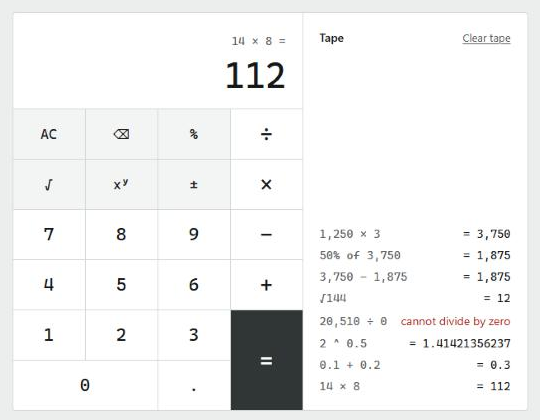

# Calculator

A React + TypeScript calculator backed by a Go REST service. The frontend does no arithmetic: every
operation is a `POST` to the Go API, and each answer (or error) is printed on a tape next to the keypad.



Operations: add, subtract, multiply, divide, power, square root, percentage.

## Run it

### With Docker (frontend + backend in one container)

```bash
docker build -t calculator .
docker run --rm -p 8080:8080 calculator
```

Open http://localhost:8080. The image is about 16 MB (a static Go binary plus the built frontend on
distroless) and runs as a non-root user.

### Locally

Requirements: Go 1.23+ and Node 20.19+.

```bash
# terminal 1: API on :8080
cd backend
go run .
```

```bash
# terminal 2: UI on :5173, proxies /api to :8080
cd frontend
npm install
npm run dev
```

Open http://localhost:5173. Set `PORT` to move the API, and `API_URL` (for example
`API_URL=http://localhost:9000 npm run dev`) to point the dev server at it.

## Tests and coverage

```bash
cd backend && go test -cover ./...
cd frontend && npm run coverage   # text summary + HTML report in frontend/coverage/
```

Current numbers:

| Layer | Package / file | Statements |
|---|---|---|
| Backend | `calc` (arithmetic, validation) | 100% |
| Backend | `server` (HTTP, JSON, status codes) | 100% |
| Frontend | `calculator.ts` (state machine) | 97.4% (100% lines) |
| Frontend | `api.ts` (HTTP client) | 100% |
| Frontend | `App.tsx` (keypad, keyboard, tape) | 100% (93.9% branches) |

`main.go` and `main.tsx` only wire things together and aren't unit tested. For an HTML Go
report: `go test -coverprofile=cover.out ./... && go tool cover -html=cover.out`.

## API

One route: `POST /api/{operation}` with a JSON body `{"operands": [...]}`.

| Operation | Operands | Result |
|---|---|---|
| `add` | `[a, b]` | a + b |
| `subtract` | `[a, b]` | a − b |
| `multiply` | `[a, b]` | a × b |
| `divide` | `[a, b]` | a ÷ b |
| `power` | `[a, b]` | a raised to b |
| `sqrt` | `[a]` | √a |
| `percentage` | `[a, b]` | a percent of b, i.e. a × b ÷ 100 |

Success is `200 {"result": n}`. Errors are `{"error": "message"}` with:

| Status | When |
|---|---|
| 400 | Malformed body: not JSON, unknown fields, `null` or non-number operands, wrong operand count, trailing data, body over 1 KB |
| 404 | Unknown operation (the message lists the supported ones) |
| 405 | Method other than POST |
| 422 | Valid input with no finite real answer: division by zero, square root of a negative, `(-8)^0.5`, overflow |

```bash
curl -X POST localhost:8080/api/add -d '{"operands":[0.1,0.2]}'
# {"result":0.3}

curl -X POST localhost:8080/api/percentage -d '{"operands":[15,200]}'
# {"result":30}

curl -X POST localhost:8080/api/sqrt -d '{"operands":[81]}'
# {"result":9}

curl -i -X POST localhost:8080/api/divide -d '{"operands":[1,0]}'
# HTTP/1.1 422 Unprocessable Entity
# {"error":"cannot divide by zero"}

curl -X POST localhost:8080/api/add -d '{"operands":[1]}'
# {"error":"wrong number of operands: add takes 2, got 1"}

curl -X POST localhost:8080/api/modulo -d '{"operands":[7,2]}'
# {"error":"unknown operation \"modulo\" (supported: add, divide, multiply, percentage, power, sqrt, subtract)"}
```

## Layout

```
backend/
  main.go            server setup (PORT, STATIC_DIR, timeouts)
  calc/              arithmetic and its errors, no HTTP
  server/            JSON API, status codes, static file serving
frontend/src/
  calculator.ts      state machine: press(state, key, compute) -> new state + tape entry
  api.ts             fetch client for the Go API
  App.tsx            keypad, keyboard shortcuts, display, tape
  styles.css         design tokens and layout
Dockerfile           node build -> go build -> distroless image
```

## Design decisions

**The backend owns the math, the frontend owns the input.** `calc` is plain Go with no HTTP, so
it's tested directly. `server` only translates JSON and errors into status codes. On the frontend,
`calculator.ts` takes the API as an injected `compute` function, so the whole state machine
(chaining, percent, errors) is tested without a network or a DOM. Editing the number being typed
(digits, decimal point, backspace, ±) stays client-side: it's input, not arithmetic.

**One route plus an operation table.** `POST /api/{operation}` looks up a map entry holding the
arity and the function. Adding an operation is one entry; there's no routing or validation code to
copy. Operands are an array, so arity is checked in one place. They decode into `*float64`
because Go's JSON decoder silently turns `null` into `0`.

**Floating point.** Numbers are `float64`, and results are rounded to 15 significant digits (the
most a float64 holds exactly in decimal). So `0.1 + 0.2` returns `0.3`, not
`0.30000000000000004`. The display then shows up to 12 significant digits, switching to scientific
notation above 10¹² and below 10⁻⁶. This is a known ceiling: exact decimal arithmetic (money)
would need `math/big` or a decimal type. Infinity and NaN can't be encoded in JSON, so they come
back as 422 errors.

**Calculator semantics.** It works like a pocket calculator, which evaluates left to right as you
go: `2 + 3 × 4 =` is `20`. Each step is one API call, and each call is one line on the tape. An
expression parser with precedence would be a different product (type a formula, evaluate once).
Other behaviors:
- Pressing two operators in a row swaps the operator.
- `12 × =` squares the number.
- `50 + 10 %` is 55 (with + or −, percent means a percent of the left operand); `50 × 10 %` is 5.
- An error keeps the expression, so after `10 ÷ 0` you type a new divisor and press `=` again.

**Keys are queued, not dropped.** Keys are applied in order. One pressed while the API is
answering waits for that answer. An early version dropped those keys; testing in the browser showed
fast input losing digits.

**Same origin everywhere.** In development, Vite proxies `/api` to the Go service. In Docker, the
Go binary serves the built frontend. Either way there's no CORS to configure.

**UI.** A calculator is a tool you operate, so there's no landing-page chrome. Results are the
content. The look follows an adding machine's paper tape: white sheet, black ink, red ink only for
errors and negative results, hairline rules instead of shadows, monospace tabular digits so columns
line up. The `=` key is the only filled key. Accessibility:
- Full keyboard support (digits, `+ - * / ^ %`, `r` for √, `F9` for ±, Enter, Backspace, Esc).
  Shortcuts are exposed through `aria-keyshortcuts` and tooltips.
- Named buttons; the display is an `<output>`, so screen readers announce results.
- Visible focus, and text contrast of at least 6:1.
- On phones the tape folds under the keypad.

**Dependencies.** The backend uses the standard library only. The frontend's only runtime
dependency is React; Vite, Vitest and Testing Library are dev-only.

**Left out on purpose:** dark mode, persisting the tape, auth or rate limiting, linting config
(TypeScript `strict` plus `go vet` and `gofmt` are the checks). All are small to add if needed.

## AI tooling

Built with Claude Code. The prompt log is shared separately with the submission.
